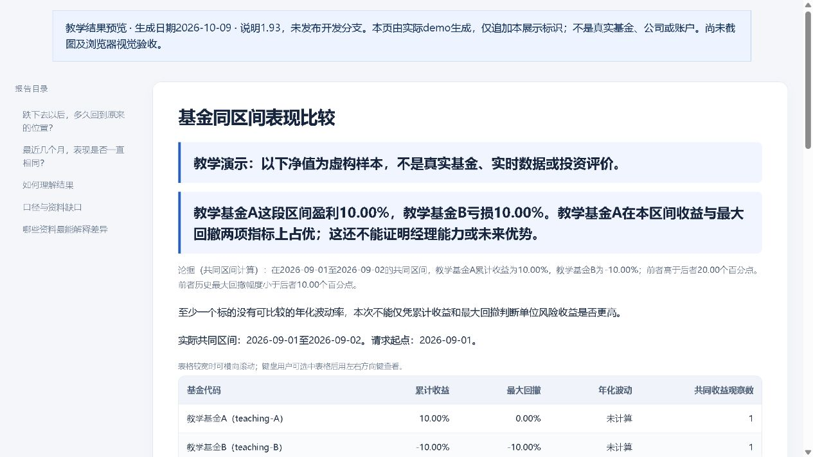

# 投研工作台

研究公司、比较基金和ETF、检查持仓组合，并沿用旧报告继续追问。

[](LICENSE) · [当前发行版 v0.1.0-beta.20](https://github.com/KILING-TASI/research-workbench/releases/tag/v0.1.0-beta.20) · [运行检查](https://github.com/KILING-TASI/research-workbench/actions)

## 能解决什么问题

**这两只基金有什么差异？利润增长有没有现金支持？上次的报告还能接着问吗？**

工作台组织资料、判断、专业工具调用和档案；专业计算由对应工具维护。可独立使用，调用其他工具时须明确其安装位置和支持范围。

## 快速开始

从[发行页](https://github.com/KILING-TASI/research-workbench/releases/tag/v0.1.0-beta.20)下载完整源码并解压，需要 Python 3.11 或以上。在源码目录执行：

```text
python try_demo.py --no-open --out-dir reports/first-demo
```

按提示打开新生成的 HTML。Windows 也可双击 `Start-Demo.cmd`，Linux/macOS 可用 `sh Start-Demo.sh`。教学使用原创模拟资料，不自动取真实数据；重复运行使用新目录，历史结果保留。

[查看已保存的报告示例](references/examples/readme-preview.html)。HTML请随完整源码下载后打开；示例按自身生成日期和口径阅读。



图片是历史示例，不能推定全部新报告已完成视觉验收。

## 使用自己的资料

先按[资料准备](BEGINNER.md)填写输入，再看[详细命令与方法](USAGE.md)。需要安装CLI时，在自己的Python环境运行：

```text
python -m pip install .
research-workbench --help
```

仓库、Python发行包、安装命令及Skill注册名均为 `research-workbench`。CLI安装和Skill注册是两个步骤：自然语言调用按[SKILL.md](SKILL.md)配置，保留完整资源；不必安装全部仓库。安装普通构建依赖可能联网，教学流程不需要作者缓存。

## 结果范围

已有资料的来源、区间和缺口必须保留；不承诺任意问题自动取齐数据或完成全市场研究。

报告中的来源、日期、假设和未知事项需一起阅读。程序运行成功不等于来源已经认证、资料完整或投资判断有效。原创代码采用MIT，第三方代码、公告、研报和数据仍按各自权利范围处理。

## 文档与维护

- [详细命令与方法](USAGE.md)
- [资料准备与排错](BEGINNER.md)
- [Skill调用指引](SKILL.md)
- [版本记录](CHANGELOG.md)
- [许可与第三方范围](THIRD_PARTY_NOTICES.md)
- [问题与证据复查](QUESTION_REVIEW.md)
- [审计范围](AUDIT_SCOPE.md)
- [扩展专题](EXPANSION.md)

[贡献说明](CONTRIBUTING.md) · [安全反馈](SECURITY.md) · [更新与清理](LIFECYCLE.md) · [English](README.en.md)

[按问题选择其他工具](https://github.com/KILING-TASI/research-workbench/blob/main/references/tool-navigation.md)。共12个活跃仓，另有1个供旧记录复查的[历史契约仓](https://github.com/KILING-TASI/cn-research-contracts)。各仓分别发布；main的后续文档整理不改写旧发行包和冻结结果。

## 单工具与Skill分发

专业工具可分别安装，工作台按问题组织调用。市场薄层的双语介绍、具体问法、标签及版本说明见[分发与调用边界](references/distribution-compatibility.md)。当前仅完成本地打包校验，尚未在第三方技能市场上架或实测导入。

## v0.1.0-beta.20 本轮补强

公司现金案例与专业工具薄调用、逐条消息证据对照、阶段进度和平台分发薄层。具体参数与边界见[使用说明](USAGE.md)。
